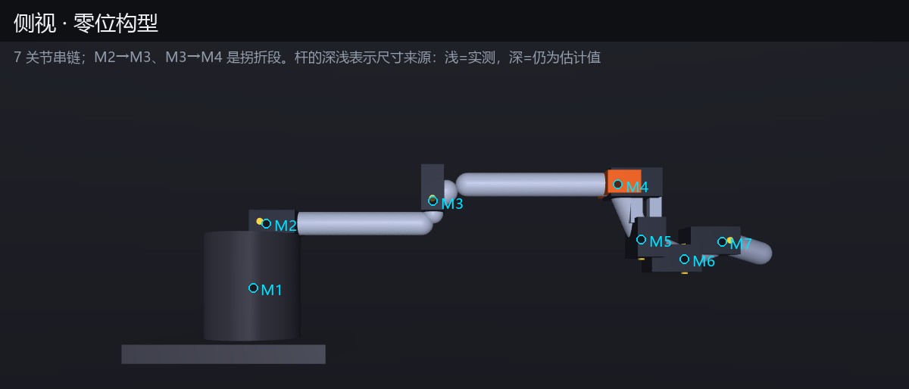
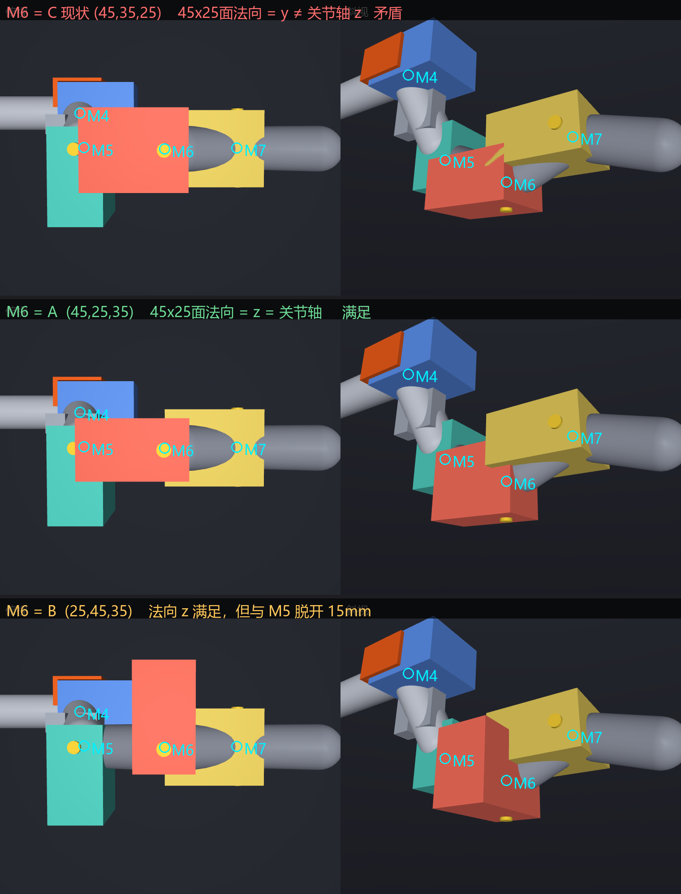

# 七轴舵机机械臂 · 参数化 MJCF 建模



**这是一个 MJCF 生成器，不是一个改好的模型文件。** 尺寸集中在 `arm_params.py`，跑一条命令生成整套
XML、几何体、舵机朝向、关节限位和自检报告；改一个尺寸，下游 6 个 body 的位置自动重算。

> **当前状态**：骨架尺寸基本就位，但 **6 处关键尺寸未确认**、动力学参数未标定、碰撞检测默认关闭。
> 本仓库目前能提供的是「一套可复算的参数化建模流程」，**不是**「一台经过验证的机械臂数字孪生」。
> 下面第 0 节把所有不确定项列在前面，请先读它。

---

## 0. 做了什么 / 没做什么

| 分类 | 内容 |
|---|---|
| **已实现** | 7 关节运动学骨架；9 段连杆（其中 M2→M3、M3→M4 是拐折段）；6 个舵机盒按"哪个面朝哪"落入世界轴；关节限位；一条命令重建 + 自检；三个一致性检查脚本 |
| **待确认** | 6 处尺寸，见 0.1 |
| **未验证** | 碰撞结论（默认关闭）、动力学可信度（惯量硬编码）、末端位置精度（依赖待确认的腕部尺寸） |
| **未做** | 线缆走线；舵机真实质量与转动惯量；齿隙的真实标定值 |

### 0.1 六处未确认的尺寸（读到就该怀疑的地方）

| 项 | 对方给的 | 模型里用的 | 影响 |
|---|---|---|---|
| M2 支点高度 | 圆柱顶面之上 **18.5 mm** | **10 mm** | 全臂高度 −8.5 mm；见下方说明 |
| M6 三个尺寸的排布 | 「45×25×35」+「输出轴沿 z」 | 45×35×25（沿用 M5） | 这两条不能同时成立，见 4.3 |
| M6 / M7 的「0 边」朝向 | 只对 M4 说过 | 按"朝上一级"推 | 每个舵机盒位置差 25 mm |
| 腕部三段长度 | 未给 | 43.9 / 38.5 / 47.1 mm（旧估计） | 直接决定末端位置 |
| 大舵机输出轴偏心 | 官方图纸未公开 | 10 mm（按标准舵机布局） | M2/M3 舵机盒位置 |
| M3 斜段角度 | 「斜向右上 35 mm」 | 按 45° 拆成 (20, 15) mm | 肘部形状 |

**M2 支点这一条值得单独说**：对方说的是圆柱顶面到 M2 轴心 18.5 mm；模型用 10 mm，理由是 M2 舵机盒
按当前朝向半厚正好 10 mm，取 10 能让盒子底面坐在圆柱顶面上。这两个值不能同时满足，是并列矛盾，
没有拍板。它对结论影响很大——把这一项从 10 改成 18.5（只差 8.5 mm），碰撞扫描里"撞底座"的占比
从 39.7% 变 34.1%、最高频碰撞对占比从 30.4% 变 20.8%。**8.5 mm 的参数误差就能让百分比动 5 个点，
所以本仓库不把任何碰撞百分比当作机械臂的属性。**

复现这两组数（协议见第 5 节）：

```bash
python build_mjcf.py --collision on --out out/c_lift10.xml
python scan_collision.py --xml out/c_lift10.xml --n 20000 --seed 0
# 再把 arm_params.py 的 M2_LIFT_Z 从 0.0100 改成 0.0185，重复上面两条
```

### 0.2 末端位置

```
零位末端（L7_tool body 原点）= (429.5, 20.0, 102.5) mm
```

**这是当前估计模型的前向运动学输出，不是实测值**，也不代表真机末端位置——腕部三段长度尚未测量。
坐标系约定：原点在底板底面中心，x 指向前方，y 指向左方，z 向上；零位 = 7 个 hinge 全部 `qpos=0`；
"末端"取 `L7_tool` body 的原点，不是笔尖实体末端。

---

## 1. 跑起来

```bash
pip install -r requirements.txt          # mujoco==3.14.0  numpy==2.2.6

python build_mjcf.py                     # 重建模型 + 自检（覆盖 arm_real.xml）
python check_axes.py                     # 7 个关节：舵机朝向推出的轴 vs 关节轴
python check_chain.py                    # 23 对相邻零件的表面间距（只判"链有没有断开"）

# 碰撞扫描：默认产物不含碰撞，需要单独生成一份开启碰撞的模型
python build_mjcf.py --collision on --out out/arm_collision.xml
python scan_collision.py --xml out/arm_collision.xml --n 20000 --seed 0

python tools/render_gallery.py           # 出图到 shots/（需 requirements-render.txt）
```

`build_mjcf.py` 第一条输出就是完整配置（`COLLISION_ON` / `backlash` / 是否画桌面 / 是否画舵机盒），
免得跑到一半才发现跑的不是同一份配置。

`check_chain.py` 会打印 **23 对里 0 处断开、15 处穿透**，看到 15 这个数不用慌：连杆是胶囊、舵机是长方体，
两者都是简化体，穿透是简化必然的产物。它只回答"装配链有没有断开"，
不回答"装配几何对不对"，也不等于真机干涉。

最短的"能用"验证——加载并读取零位末端：

```python
import mujoco
m = mujoco.MjModel.from_xml_path("arm_real.xml")
d = mujoco.MjData(m); mujoco.mj_forward(m, d)
print(d.xpos[mujoco.mj_name2id(m, mujoco.mjtObj.mjOBJ_BODY, "L7_tool")])
```

---

## 2. 模型的实际构成

以下数字都是编译 `MjModel` 之后直接读出来的，不是数 XML 行数得来的：

| 量 | 值 | 口径 |
|---|---|---|
| `nbody` | **11** | **含 `world`**；实体 body 10 个 = `base` + 9 段 |
| `njnt` | 7 | 全部是 hinge，无 free joint |
| `nq` = `nv` | 7 | 广义位置/速度维数；7 个单自由度 hinge 时恰好等于关节数 |
| `ngeom` | 28 | 桌面 1 + 底板 1 + 舵机舱 1 + 舵机盒 6 + 输出轴 6 + 连杆胶囊 8 + U 型延长臂 3 + 连接件 2 |
| `nu` | 7 | 7 个位置伺服 |
| MjModel 总质量 | 1.656 kg | 各 body `body_mass` 求和（其中底座 0.896 kg） |

拓扑上三个词不是一回事，容易混：

```
节(chain) = 一条从关节到下一关节的运动链，7 节
段(seg)   = 节内部的直线胶囊，L2/L3 各有 2 段，所以 9 段
body      = MJCF 实体，一个 body 可以挂多段（拐折段共用同一关节）
```

即 `7 节 → 9 段 → 10 个实体 body`。`L2_upper_b`、`L3_fore_b` 是挂在父 body 下的子 body，没有自己的关节。
9 段里 `L1_base_m2` 长度为 0、半径 0，只承载 M1 关节而不建几何，所以实际画出来的连杆胶囊是 8 个。

---

## 3. 参数来源：谁给了什么

**覆盖范围要说清**：几何尺寸里有一部分是对方用卡尺量完口述的，其余是照片反推、常识占位、
旧模型沿用或体积估算。`arm_params.py` 每一项都自带来源标记，共 6 种：

| 标记 | 含义 | 现状 |
|---|---|---|
| `[实测]` | 对方量过或舵机回读 | 底板、舵机舱、连杆长度、杆径、舵机外形、U 型支架、M4/M5 限位 |
| `[估计]` | 照片反推或旧模型沿用 | 腕部三段长度、M1~M3 的质量与力矩 |
| `[待测]` | 明确知道要量、还没量 | `L1_base_m2` 的占位质量 |
| `[待确认]` | 有两句冲突的话，等人拍板 | M6 尺寸排布、M6 限位语义、M7 轴向 |
| `[未核实]` | 官方图纸没公开，按行业惯例填 | 大舵机输出轴偏心 10 mm |
| （无标记） | 生成器自己的规则常数 | `0.45` 半径夹取系数、`2 mm` 板厚→胶囊半径 |

规矩只有一条：**缺的地方宁可留旧估计并标 `[估计]`，也不填一个"看起来合理"的假数字。**
理由很实际——假数字会让碰撞扫描的结果看起来很像那么回事，然后你去改的是假问题。

这条规矩被违反过。`docs/PARAMS.md` 末尾有一张「已纠正的错误」表，记了四次"用推理覆盖数据"：
把对方明确给的 2.5 mm 偏心改成居中、把输出轴方向按"物理上更合理"改掉、把 M2 支点从 18.5 mm
改成 10 mm。**四次里有三次的动机都是"物理上更合理"或"图纸对不上"——这类直觉不是证据**，
真机不会因为我觉得它更合理就变成那样。这类错误比任何技术 bug 都重，因为它把一个事实变成了一个猜测。

---

## 4. 三个技术细节

### 4.1 胶囊：目标长度、球心距、`0.45`

三个数必须分开写，混成一个就会出现"表格里的数算不通"：

| 符号 | 是什么 | 由谁决定 | 关系 |
|---|---|---|---|
| `L` | **目标外形总长**（= 关节轴心距，生成器的输入） | `arm_params.py` | 我想要多长 |
| `d` | **传给 MuJoCo 的球心距**（`fromto` 两端点距离） | 生成器算出来的 | MuJoCo 只看它 |
| `r` | 半径 | `arm_params.py` | |

**第一行 · MuJoCo 的行为**：它只认 `d` 和 `r`，几何总长 = `d + 2r`。`d` 不能为 0——
3.14.0 上实测 1 µm 能过、0 报 `fromto points too close in geom`（**介于此之间的阈值未测**，见下方表格后的说明）。
它不知道也不关心"我想做多长"。

**第二行 · 本生成器的构造**：由目标总长反解球心，`d = |L − 2r|`，球心偏移 `±(L/2 − r)`。
`r < L/2` 时 `d = L − 2r`，几何总长 `= (L − 2r) + 2r = L`，精确等于想要的长度：

```python
L    = |vec|                       # 目标总长
r    = radius
if r > 0.45 * L: r = 0.45 * L      # 仍会截断，只是现在会报警
half = L / 2.0 - r                 # 球心相对 body 原点的偏移
a    = u * r                       # 球心 1
b    = u * (L - r)                 # 球心 2，|b − a| = L − 2r = d
```

**第三行 · `r > L/2` 时那个"负端点距"是本生成器的代数产物，不是 MuJoCo 接受负长度**：
`L/2 − r` 变成负数，`a`、`b` 两点位置互换，写进 `fromto` 后 MuJoCo 看到的仍是 1 mm 的**正**距，
于是总长 `= 2r + (2r − L) = 4r − L`，不再等于 `L`。

在 mujoco 3.14.0 上实测（直接构造 `fromto` 喂给 MuJoCo，绕开生成器）。
**`L − 2r` 和 `|L − 2r|` 是两个量，别混**：前者是沿杆方向的有向差，可以为负；
后者才是两个端点之间的欧氏距离，**永远非负**——距离这个概念本身不允许负值。

| 构造 | 有向差 `L − 2r` | 端点距 `\|L − 2r\|` | MuJoCo 看到的几何总长 |
|---|---|---|---|
| `L=44, r=10.5`（6.1 < 22） | `+23 mm` | `23 mm` | 编译通过，包围盒 **44.000 mm** ✓ |
| `L=20, r=10.5`（10.5 > 10） | **`−1 mm`** | **`1 mm`**（两点换位后仍是正距） | 编译通过，**22.000 mm ≠ 20** ✗ |
| `L=44, r=22`（`r = 0.5L`） | `0 mm` | `0 mm` | **报错 `fromto points too close in geom`** |
| 直接给 `d = 0.001 mm` | —（不涉及 `L`） | `0.001 mm` | 编译通过 |

**边界结论按实测原样写，不外推**：

- **重合不行、1 µm 可以。** 在 **3.14.0** 上 `d = 0` 报错、`d = 0.001 mm` 通过。
  **更小的非零距离没测**，实现里可能存在非零的数值退化阈值（float32 精度、`fromto` 归一化都可能引入），
  所以只能说"本版本测试中重合报错、相距 1 µm 通过，阈值未验证"，
  **不能说"准确的边界就是两端点不重合"**——那是从两个采样点反推阈值，不成立。
  要给出准确阈值得直接读 3.14.0 的 `fromto` 编译判据（`user_model.cc` 里对 `fromto` 长度做检查那段），本仓没做。
- **`r > L/2` 会让总长变成 `4r − L`。** 这一条对任何版本的 MuJoCo 都成立，因为它只是几何算术；
  MuJoCo 不检查、不报警，**得生成器自己管**。

`0.45` 是生成器留的 10% 余量，用来同时避开这两件事——**它是我们的参数，不是 MuJoCo 的要求**。

### 4.2 截断这件事只加了日志，没修几何

当前参数下唯一触发的是 `L2_upper_b`（L=20.0 mm，r 10.5 → 9.0，细了 14.3%）。历史上有三段腕部被砍掉
约四分之一（`L4_wr1`/`L5_wr2`：r 26 → 19.74；`L6_wr3`：r 24 → 17.32），那是旧参数下的记录，
现在已经按杆径 21 mm 统一取半径 10.5 mm。

必须分清两件事：

- **已解决**：静默。每段都会打印「填 r / 生效 r / 长度」，被夹的标 `<< L 太短`。
- **未解决**：几何。半径仍被无条件缩小，被缩的那一段形状就是错的。

对后者的正确处理是报错终止或者换一种几何表达，让使用者决定，而不是替他收窄。这一条还挂着。

> 一般化的教训：**一个"自动帮你修正"的默认行为，如果不说出来，它就在制造你不知道的偏差。**
> 这类静默行为在 CAD/CAE 工具链里到处都是（单位换算、网格简化、容差吸附）。

### 4.3 舵机朝向与 M6 的三个候选

对方描述舵机尺寸的方式是"哪个面朝哪"，不是"哪个尺寸沿哪根轴"。M3 的原话：

> 「m3 的 40x40 面是垂直于 x 轴的」「输出轴与 y 轴平行」「双轴在 40x20 面上」

这三句落在同一个 40×40×20 的箱体上，翻译过程写在 `arm_params.py` 的注释里：

```
"40x40面垂直于x轴"  -> 法向 ±x  -> 沿 x = 20
"输出轴与y轴平行"    -> 输出轴沿 y
"双轴在40x20面上"    -> 法向 y 的面 = x*z = 20*40 = 40x20  ✓ 自洽
```

最后那句 `✓ 自洽` 是校验：三条口径必须能同时成立，不成立就说明有一句理解错了。
**但要注意**：单看「40×40×20」这一个三元组推导不出任何轴向——`40×40×20` 的箱体本来就有
2 个 40×40 面和 4 个 40×20 面。真正定向的是「哪个面朝哪个轴」这些附加语句，不是尺寸本身。

关于坐标：对方给的是**面局部坐标系里的绝对点**（`45×25` 面的四个角 (0,0)(0,25)(45,25)(45,0)，
输出轴在 (10, 12.5)，0 边朝上一级）。模型直接存这个点，用时现算 `p_body = R·p_local + t`。
存绝对点能避免"偏心 +12.5 还是 −12.5"这类反复换算的错误，但它仍然是局部坐标，换到 body/世界
坐标照样需要正确的刚体变换——**这里消除的是存储歧义，不是变换错误。**

M6 是唯一一个怎么排都对不上的：

| 方案 | 沿x | 沿y | 沿z | 45×25 面法向 | 顶面是什么 | 与 M5 的盒间距 |
|---|---|---|---|---|---|---|
| **C 现状** | 45 | 35 | 25 | y ≠ z ✗ | 45×35（不是轴穿出的那面） | −7.5 mm |
| **A** | 45 | 25 | 35 | z ✓ | 45×25 ✓ | −7.5 mm |
| **B（同 M5 装法）** | 25 | 45 | 35 | z ✓ | 45×25 ✓ | **+15 mm** |



左列正俯视（看轴穿出的那个面是否朝上），右列斜视。**A 是满足法向约束的候选之一**，但它与 M5 的盒间距
是 −7.5 mm（有符号表面距离，负值代表几何穿透）——穿透既可能对应真实的结构交叠，也可能说明这两颗舵机
之间缺一个过渡件。所以这里写"候选 A"，不写"唯一解"，最终要按输出轴同轴度、安装孔位和支架连接点来定，
不是按"盒间距不为正"来定。

矛盾是被脚本抓出来的，不是看出来的。`check_axes.py` 分两段：第一段核对"舵机朝向推出的轴 == 关节轴"
（两项同源，只能发现内部不自洽，所以全 OK 说明不了实物对）；第二段单独核对"45×25 面的法向 == 关节轴"，
不重合就打 `!!`：

```console
$ python check_axes.py
  M6_wr      ORIENT=(45, 35, 25)   45在x 25在z -> 法向=y  关节轴=z  !! 法向 y != 关节轴 z
```

**它是参数一致性检查，不是实物验证。** 对真实转轴来说，方向平行还不够，轴线位置、正负号都要单独核对
（轴线距离由 `check_chain.py` 用 `mj_geomDistance` 给出，负数表示两个包围体互相穿透）。

---

## 5. 碰撞：本仓库不提供经验证的结论

`arm_params.py:439` → `COLLISION_ON = False`，生成出来的模型里 28 个 geom 的
`contype / conaffinity` 唯一值都是 `0`。**全部 geom 不参与碰撞。**

即使用 `--collision on` 单独生成一份，参与碰撞的也只有 **11 个 geom**：桌面、底板、舵机舱、8 个连杆胶囊。
**舵机盒、输出轴、U 型延长臂一律 `contype=0`**，所以"舵机盒撞舵机盒""线束刮舵机"这类情况这套扫描
根本看不到——它只能查连杆与连杆、连杆与底座、连杆与桌面。这个边界必须和数字一起看。

**「11 个」的依据**在 `check_collision_set.py` 里，从编译后的 `MjModel` 读，不是数 XML 行：

```console
$ python build_mjcf.py --collision on --out out/arm_collision.xml
$ python check_collision_set.py
① 掩码活跃（contype!=0 或 conaffinity!=0）= 11 个；其中 contype!=0 的 = 11 个
② 掩码相容的 geom 对 = 55 对（不含显式 pair）
     同 body 被排除     = 1 对
     父子 body 被排除   = 9 对
     被 exclude 排除    = 0 对
③ 四条件全过、可能互碰的 geom 对 = 45 对（含显式 pair 0 个）
④ 出现在 ③ 里的 geom = 11 个
```

**为什么不能只凭 `contype=0` 就下结论**：MuJoCo 的碰撞过滤要四条同时成立——
掩码相容 `(contype_i & conaffinity_j) || (contype_j & conaffinity_i)`、不同 body、
互不为对方的 parent body、没被 `<contact><exclude>` 排除（或被 `<contact><pair>` 显式指定）。
只把 `contype` 置 0、而 `conaffinity` 非 0 时，反向那一条仍可能匹配。本模型这两项**同时**为 0，
`npair=0`、`nexclude=0`，所以"不参与"成立；父子关系另外吃掉了 9 对。
注意 `①` 和 `④` 都是 11 但含义不同，别当成"11 个 geom 互相都碰"——真正的互碰潜力是 `③` 那 45 对。

原因：现阶段目标是先把几何/运动学骨架建准，不是判撞。历史上算过的碰撞比例是在"腕部半径被静默砍掉
四分之一"的模型上得到的，真机更粗、更容易撞，所以那些数字偏乐观；后来又发现底座参数整体错了一版。
**两批结论对应两个不同版本的模型，都没有经过真机验证，本仓库不引用任何一个具体百分比。**

`scan_collision.py` 保留着，但它现在的产物只在指定协议下才有意义。协议本身写死在输出头部，跑一次就能看到：

```console
$ python scan_collision.py --n 20000
模型: arm_real.xml
     nbody=11 ngeom=28（其中参与碰撞 0 个）mujoco=3.14.0
!! 该模型 contype/conaffinity 全为 0，碰撞被关闭，下面所有百分比都会是 0。
   先跑：python build_mjcf.py --collision on --out out/arm_collision.xml
   再跑：python scan_collision.py --xml out/arm_collision.xml
关节: M1_yaw, M2_should, M3_elbow, M4_wp, M5_wy, M6_wr, M7_tool
采样: 每关节在 jnt_range 内独立均匀   n=20000  seed=0
限位: M1_yaw[-135.0,135.0]  M2_should[-90.0,90.0]  ...  M7_tool[-180.0,180.0]
判据: d.ncon>0 且接触对至少一方为 g_* 连杆胶囊；每姿态只记首个命中（优先级 self>base>table）
```

要复现一次扫描，必须把这些一起抄走：**每关节在 `jnt_range` 内独立均匀采样**（不是按可达性加权）、
`n`、`seed`、以及"每个姿态只记第一个命中的类别"（三类不互斥，占比之和不代表真实分布）。
另外 MuJoCo 默认不检测父子 body 之间，所以"自碰撞"实际只覆盖**不相邻**的连杆。

正因为百分比对这个协议高度敏感，本仓库只写方法不写结论。真想用它，正确用法是比较两个参数版本
（见 0.1 的 8.5 mm 实验），而不是把它当成机械臂的固有属性。

---

## 6. 动力学：能跑，但没标定

MuJoCo 会正常算动力学——问题在于结果没有物理可信度：

- **质量**：每段的质量是 `arm_params.py` 里手填的常数（0.03~0.11 kg），与该条目旁边的"尺寸来源"标记
  不是一回事——尺寸是量过的，质量没有称重记录。舵机盒 geom 没给 `mass`，由 MuJoCo 按体积和默认密度
  推算，40×40×20 得约 32 g，同尺寸真舵机在 60 g 量级。
- **惯量**：10 个实体 body 里有 **7 个**的 `diaginertia` 是**硬编码常数**（`1e-5` 或 `1e-4`），与质量、尺寸
  无关；只有 `L2_upper_b`、`L3_fore_b` 和 `base` 三个是从几何算出来的。质心全部写死在 body 原点。
- **执行器**：7 个位置伺服，力矩上限来自舵机标称值，没有实测电流曲线、摩擦和阻尼。

所以准确说法是：**可以运行动力学，但尚不具备经过标定的动力学预测能力。**

---

## 7. 兼容性与确定性

**兼容性**：`arm_real.xml` 已在 **mujoco 3.14.0**（Python 3.13.14 / numpy 2.2.6，Windows）上用
`MjModel.from_xml_path` 加载通过，最小命令见第 1 节。其它 MuJoCo 版本、其它封装（mujoco-py、
MuJoCo Python bindings 的旧 API）**未测试**，不承诺"任何工具链都能加载"。

**确定性**：同机同版本下，删掉 `arm_real.xml` 重跑三次得到同一个 md5：

```console
$ python build_mjcf.py >/dev/null && md5sum arm_real.xml
d6280c8e018d2ad6b8f47fb7f2928ef1 *arm_real.xml   (重复 3 次一致)
```

这是手动的三次观测，不是 CI。跨 Python 版本、跨平台、跨 MuJoCo 版本的一致性没有验证过。

---

## 8. 目录

```
arm_params.py              尺寸与来源标记（改这里）
build_mjcf.py              生成器 + 自检报告
arm_real.xml               产物，不手改（下次生成会被覆盖）
check_axes.py              关节轴一致性（参数自洽，非实物验证）
check_chain.py             23 对相邻零件的表面间距（只回答"链有没有断开"）
scan_collision.py          随机采样扫描 + 关节对热力图
tools/render_gallery.py    出图（自适应取景 + FK 标注）
tools/render_poses.py      姿态渲染 + 碰撞高亮
tools/m6_compare.py        M6 三个方案的对比图
requirements.txt           生成/检查依赖（锁版本）
requirements-render.txt    出图依赖
docs/PARAMS.md             参数总账：原话、来源分级、已纠正的错误
docs/SEGMENTS.md           逐段访谈记录 + 拐折拓扑
docs/BASELINE.md           改造前的旧模型基线
docs/ITERATIONS.md         三轮迭代：首轮数据作废、碰撞结论失效的原因
docs/DECISIONS.md          待拍板的 3 件事（M6 排布 / 0 边朝向 / 腕部长度）
shots/                     图（终态截图）
```

---

## 许可

MIT，见 [LICENSE](LICENSE)。代码与文档可自由使用；模型尺寸来自真实硬件的口述测量，
引用时请注明来源与未确认项。
